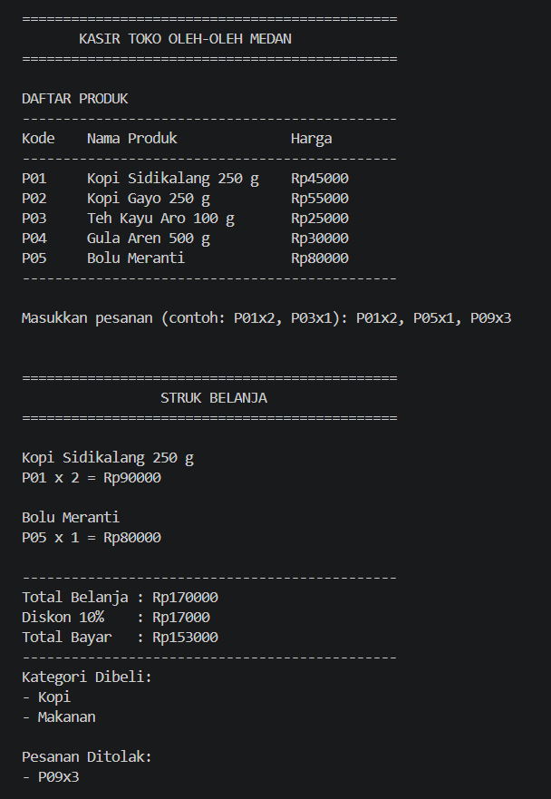
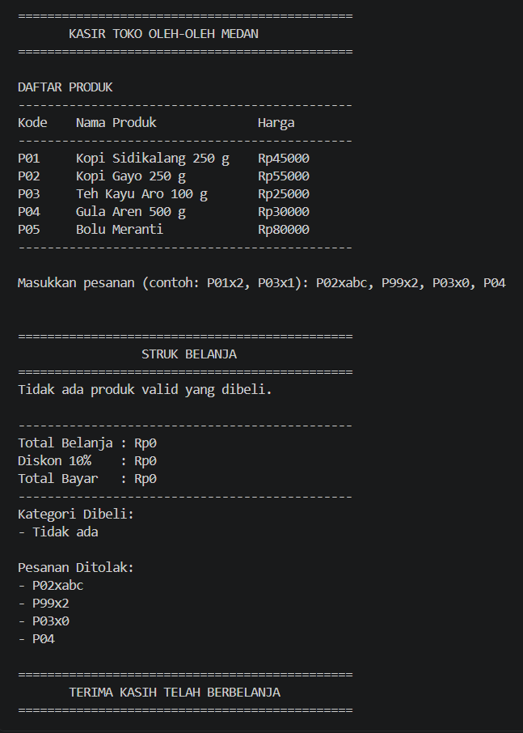

# Aplikasi Kasir Console - Tugas Rutin 2

## Identitas
- **Nama:** Tegas Ramadhan
- **NIM:** 4243250043
- **Mata Kuliah:** Pemrograman Mobile
- **Program Studi:** Ilmu Komputer
- **Universitas:** Universitas Negeri Medan

## Deskripsi
Aplikasi Kasir Console merupakan program sederhana untuk membantu proses transaksi pada toko oleh-oleh di Medan. Aplikasi ini dibuat menggunakan bahasa pemrograman Dart dan dijalankan melalui terminal. Program menyediakan daftar produk, menerima pesanan berdasarkan kode produk dan jumlah, menghitung subtotal, memberikan diskon 10% untuk transaksi minimal Rp100.000, serta menampilkan struk belanja. Program juga dapat menangani kode produk dan jumlah pesanan yang tidak valid tanpa menghentikan aplikasi.

## Daftar Produk
| Kode | Nama Produk | Kategori | Harga |
|---|---|---|---:|
| P01 | Kopi Sidikalang 250 g | Kopi | Rp45.000 |
| P02 | Kopi Gayo 250 g | Kopi | Rp55.000 |
| P03 | Teh Kayu Aro 100 g | Teh | Rp25.000 |
| P04 | Gula Aren 500 g | Pemanis | Rp30.000 |
| P05 | Bolu Meranti | Makanan | Rp80.000 |

## Cara Menjalankan
Pastikan Dart SDK sudah terpasang, kemudian jalankan perintah berikut melalui terminal pada folder project:

```bash
dart run bin/kasir.dart
```

Format input pesanan menggunakan kode produk dan jumlah, contohnya:

```text
P01x2, P03x1
```

## Screenshot Pengujian

### 1. Pengujian Pesanan Valid dan Tidak Valid
Pengujian menggunakan input:

```text
P01x2, P05x1, P09x3
```

Hasil yang diharapkan:
- Total belanja: Rp170.000
- Diskon 10%: Rp17.000
- Total bayar: Rp153.000
- Produk P09x3 ditolak karena kode tidak tersedia.



### 2. Pengujian Input Tidak Valid
Pengujian menggunakan input:

```text
P02xabc, P99x2, P03x0, P04
```

Hasil yang diharapkan:
- Semua pesanan ditolak.
- Total belanja: Rp0.
- Total bayar: Rp0.
- Program tetap berjalan tanpa error.



## Penjelasan Konsep Dart

`var` digunakan ketika tipe data variabel dapat disimpulkan secara otomatis oleh Dart. Pada program ini, `var` digunakan untuk menyimpan input pesanan pengguna pada baris 27. `final` digunakan untuk variabel yang hanya dapat diberikan nilai satu kali, contohnya katalog produk pada baris 6. Sementara itu, `const` digunakan untuk menyimpan nilai tetap yang sudah diketahui saat kompilasi, seperti nama toko pada baris 4.

Null safety diterapkan untuk mencegah kesalahan akibat penggunaan nilai kosong atau null. Pada baris 43, tipe data `int?` digunakan karena hasil `int.tryParse()` dapat menghasilkan null apabila input bukan angka. Selanjutnya, pada baris 48, program memeriksa apakah produk atau jumlah pesanan bernilai null sebelum diproses. Dengan demikian, program dapat menangani input yang tidak valid tanpa mengalami crash.

## Pernyataan Penggunaan AI

AI digunakan sebagai alat bantu dalam memahami konsep Dart, menyusun kode awal, dan memperbaiki kesalahan selama proses pengembangan. Pengujian program dan pemahaman terhadap kode dilakukan kembali oleh penulis.